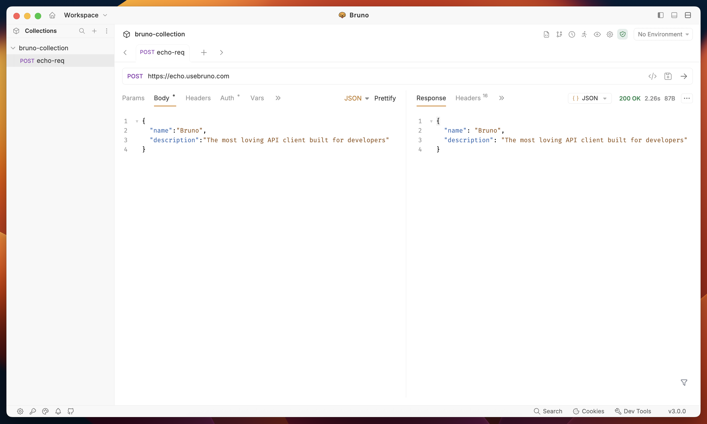

<br />


### Jackpost - Opensource IDE per esplorare e testare gli APIs.

[](https://badge.fury.io/gh/usejackpost%2Fjackpost)
[](https://github.com/usejackpost/jackpost/actions/workflows/tests.yml)
[](https://github.com/usejackpost/jackpost/pulse)
[](https://twitter.com/use_jackpost)
[](https://www.usejackpost.com)
[](https://www.usejackpost.com/downloads)

[English](../../readme.md)
| [Українська](./readme_ua.md)
| [Русский](./readme_ru.md)
| [Türkçe](./readme_tr.md)
| [Deutsch](./readme_de.md)
| [Français](./readme_fr.md)
| [Português (BR)](./readme_pt_br.md)
| [한국어](./readme_kr.md)
| [বাংলা](./readme_bn.md)
| [Español](./readme_es.md)
| **Italiano**
| [Română](./readme_ro.md)
| [Polski](./readme_pl.md)
| [简体中文](./readme_cn.md)
| [正體中文](./readme_zhtw.md)
| [العربية](./readme_ar.md)
| [日本語](./readme_ja.md)
| [ქართული](./readme_ka.md)
| [हिन्दी](./readme_hi.md)

Jackpost è un nuovo ed innovativo API client, mirato a rivoluzionare lo status quo rappresentato da Postman e strumenti simili disponibili.

Jackpost memorizza le tue raccolte direttamente in una cartella del tuo filesystem. Utilizziamo un linguaggio di markup in testo semplice chiamato Jp per salvare informazioni sulle richeste API.

Puoi utilizzare Git o qualsiasi sistema di controllo che preferisci per collaborare sulle tue raccolte di API.

Jackpost funziona solo in modalità offline. Non ci sono piani per aggiungere la sincronizzazione su cloud a Jackpost in futuro. Valorizziamo la privacy dei tuoi dati e crediamo che dovrebbero rimanere sul tuo dispositivo. Puoi leggere la nostra visione a lungo termine [qui (in inglese)](https://github.com/usejackpost/jackpost/discussions/269)

📢 Guarda la nostra presentazione più recente alla conferenza India FOSS 3.0 [qui](https://www.youtube.com/watch?v=7bSMFpbcPiY)

 <br /><br />

### Installazione

Jackpost è disponibile come download binario [sul nostro sito](https://www.usejackpost.com/downloads) per Mac, Windows e Linux.

Puoi installare Jackpost anche tramite package manger come Homebrew, Chocolatey, Snap e Apt.

```sh
# Su Mac come Homebrew
brew install jackpost

# Su Windows come Chocolatey
choco install jackpost

# Su Linux tramite Snap
snap install jackpost

# Su Linux tramite Apt
sudo mkdir -p /etc/apt/keyrings
sudo apt update && sudo apt install gpg curl
curl -fsSL "https://keyserver.ubuntu.com/pks/lookup?op=get&search=0x9FA6017ECABE0266" \
  | gpg --dearmor \
  | sudo tee /etc/apt/keyrings/jackpost.gpg > /dev/null
sudo chmod 644 /etc/apt/keyrings/jackpost.gpg
echo "deb [arch=amd64 signed-by=/etc/apt/keyrings/jackpost.gpg] http://debian.usejackpost.com/ jackpost stable" \
  | sudo tee /etc/apt/sources.list.d/jackpost.list
sudo apt update && sudo apt install jackpost
```

### Funziona su diverse piattaforme 🖥️

 <br /><br />

### Collabora tramite Git 👩‍💻🧑‍💻

O con qualsiasi sistema di controllo di versioni a tua scelta

 <br /><br />

### Collegamenti importanti 📌

- [La nostra visione a lungo termine](https://github.com/usejackpost/jackpost/discussions/269)
- [Roadmap](https://github.com/usejackpost/jackpost/discussions/384)
- [Documentazione](https://docs.usejackpost.com)
- [Sito internet](https://www.usejackpost.com)
- [Prezzo](https://www.usejackpost.com/pricing)
- [Download](https://www.usejackpost.com/downloads)

### Showcase 🎥

- [Testimonianze](https://github.com/usejackpost/jackpost/discussions/343)
- [Centro di conoscenza](https://github.com/usejackpost/jackpost/discussions/386)
- [Scriptmania](https://github.com/usejackpost/jackpost/discussions/385)

### Supporto ❤️

Woof! se ti piace il progetto, premi quel ⭐ pulsante !!

### Testimonianze condivise 📣

Se Jackpost ti ha aiutato con il tuo lavoro ed il tuo team, per favore non dimenticare di condividere le tue [testimonianze nella nostra discussione su GitHub](https://github.com/usejackpost/jackpost/discussions/343)

### Pubblica Jackpost su un nuovo gestore di pacchetti

Per favore vedi [qui](../../publishing.md) per accedere a più informazioni.

### Contribuire 👩‍💻🧑‍💻

Sono felice che vuoi migliorare Jackpost. Per favore controlla la [guida per la partecipazione](../contributing/contributing_it.md)

Anche se non sei in grado di contribuire tramite il codice, non esitare a segnalare bug e richieste di funzionalità che devono essere implementati per risolvere il tuo caso d'uso.

### Autori

<div align="center">
    <a href="https://github.com/usejackpost/jackpost/graphs/contributors">
        
    </a>
</div>

### Resta in contatto 🌐

[𝕏 (Twitter)](https://twitter.com/use_jackpost) <br />
[Sito internet](https://www.usejackpost.com) <br />
[Discord](https://discord.com/invite/KgcZUncpjq) <br />
[LinkedIn](https://www.linkedin.com/company/usejackpost)

### Marchio

**Nome**

`Jackpost` è un marchio registrato appartenente a [Anoop M D](https://www.helloanoop.com/)

**Logo**

Il logo è stato creato da [OpenMoji](https://openmoji.org/library/emoji-1F436/). Licenza: CC [BY-SA 4.0](https://creativecommons.org/licenses/by-sa/4.0/)

### Licenza 📄

[MIT](../../license.md)
