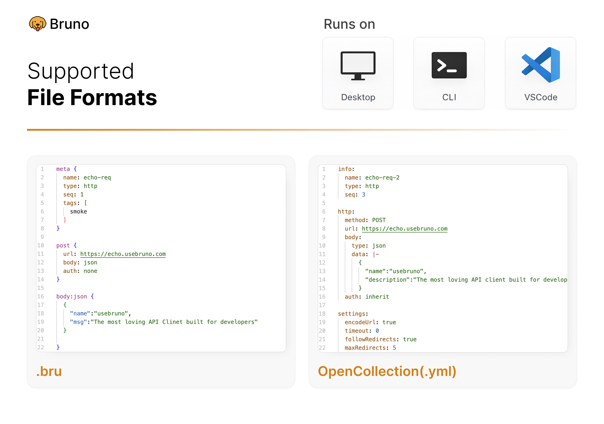

<br />


### Jackpost - API 탐색 및 테스트를 위한 오픈소스 IDE.

[](https://badge.fury.io/gh/usejackpost%2Fjackpost)
[](https://github.com/usejackpost/jackpost/actions/workflows/tests.yml)
[](https://github.com/usejackpost/jackpost/pulse)
[](https://twitter.com/use_jackpost)
[](https://www.usejackpost.com)
[](https://www.usejackpost.com/downloads)

[English](../../readme.md)
| [Українська](./readme_ua.md)
| [Русский](./readme_ru.md)
| [Türkçe](./readme_tr.md)
| [Deutsch](./readme_de.md)
| [Français](./readme_fr.md)
| [Português (BR)](./readme_pt_br.md)
| **한국어**
| [বাংলা](./readme_bn.md)
| [Español](./readme_es.md)
| [Italiano](./readme_it.md)
| [Română](./readme_ro.md)
| [Polski](./readme_pl.md)
| [简体中文](./readme_cn.md)
| [正體中文](./readme_zhtw.md)
| [العربية](./readme_ar.md)
| [日本語](./readme_ja.md)
| [ქართული](./readme_ka.md)
| [हिन्दी](./readme_hi.md)

Jackpost는 새롭고 혁신적인 API 클라이언트로, Postman과 유사한 툴들을 혁신하는 것을 목표로 합니다.

Jackpost는 사용자의 컬렉션을 파일 시스템의 폴더에 직접 저장합니다. 일반 텍스트 마크업 언어인 Jp를 사용해 API 요청에 대한 정보를 저장합니다.

Git 또는 원하는 버전 관리 도구를 사용하여 API 컬렉션을 연동할 수 있습니다.

브루는 오프라인 전용입니다. 브루노에 클라우드 동기화 기능을 추가할 계획은 없습니다. 저희는 사용자의 데이터 프라이버시를 소중히 여기며, 데이터는 사용자의 기기에 남아 있어야 한다고 믿습니다. 장기 비전 읽기 [링크](https://github.com/usejackpost/jackpost/discussions/269)

📢 Watch our recent talk at India FOSS 3.0 Conference [here](https://www.youtube.com/watch?v=7bSMFpbcPiY)

 <br /><br />

### 설치

Jackpost 는 여기에서 다운로드 받을 수 있습니다.[링크](https://www.usejackpost.com/downloads) (맥, 윈도우, 리눅스)

Homebrew, Chocolatey, Snap, Apt 같은 패키지 관리자를 통해서도 Jackpost를 설치할 수 있습니다.

```sh
# On Mac via Homebrew
brew install jackpost

# On Windows via Chocolatey
choco install jackpost

# On Linux via Snap
snap install jackpost

# On Linux via Apt
sudo mkdir -p /etc/apt/keyrings
sudo apt update && sudo apt install gpg curl
curl -fsSL "https://keyserver.ubuntu.com/pks/lookup?op=get&search=0x9FA6017ECABE0266" \
  | gpg --dearmor \
  | sudo tee /etc/apt/keyrings/jackpost.gpg > /dev/null
sudo chmod 644 /etc/apt/keyrings/jackpost.gpg
echo "deb [arch=amd64 signed-by=/etc/apt/keyrings/jackpost.gpg] http://debian.usejackpost.com/ jackpost stable" \
  | sudo tee /etc/apt/sources.list.d/jackpost.list
sudo apt update && sudo apt install jackpost
```

### 여러 플랫폼에서 실행하세요. 🖥️

 <br /><br />

### Git과 연동하세요. 👩‍💻🧑‍💻

또는 원하는 버전 관리 시스템을 선택하세요.

 <br /><br />

### 중요 링크 📌

- [Our Long Term Vision](https://github.com/usejackpost/jackpost/discussions/269)
- [Roadmap](https://github.com/usejackpost/jackpost/discussions/384)
- [Documentation](https://docs.usejackpost.com)
- [Website](https://www.usejackpost.com)
- [Pricing](https://www.usejackpost.com/pricing)
- [Download](https://www.usejackpost.com/downloads)

### 쇼케이스 🎥

- [Testimonials](https://github.com/usejackpost/jackpost/discussions/343)
- [Knowledge Hub](https://github.com/usejackpost/jackpost/discussions/386)
- [Scriptmania](https://github.com/usejackpost/jackpost/discussions/385)

### 지원 ❤️

프로젝트가 마음에 들면 ⭐ 버튼을 눌러 주세요.

### 후기 공유 📣

Jackpost가 여러분과 여러분의 팀에 도움이 되었다면, 잊지 말고 공유해 주세요. [GitHub discussion 공유 링크](https://github.com/usejackpost/jackpost/discussions/343)

### 새 패키지 관리자에게 게시

더 많은 정보를 확인하시려면 링크를 클릭해 주세요. [배포 가이드](../../publishing.md)

### 컨트리뷰트 👩‍💻🧑‍💻

컨트리뷰트에 관심이 있으시면 링크를 참고해 주세요. [컨트리뷰트 가이드](../contributing/contributing_kr.md)

코드를 통해 기여할 수 없더라도 사용 사례를 해결하기 위해 구현이 필요한 버그나 기능 요청을 주저하지 마시고 제출해 주세요.

### Authors

<div align="center">
    <a href="https://github.com/usejackpost/jackpost/graphs/contributors">
        
    </a>
</div>

### Stay in touch 🌐

[𝕏 (Twitter)](https://twitter.com/use_jackpost) <br />
[Website](https://www.usejackpost.com) <br />
[Discord](https://discord.com/invite/KgcZUncpjq) <br />
[LinkedIn](https://www.linkedin.com/company/usejackpost)

### Trademark

**Name**

`Jackpost` is a trademark held by [Anoop M D](https://www.helloanoop.com/)

**Logo**

The logo is sourced from [OpenMoji](https://openmoji.org/library/emoji-1F436/). License: CC [BY-SA 4.0](https://creativecommons.org/licenses/by-sa/4.0/)

### License 📄

[MIT](../../license.md)
